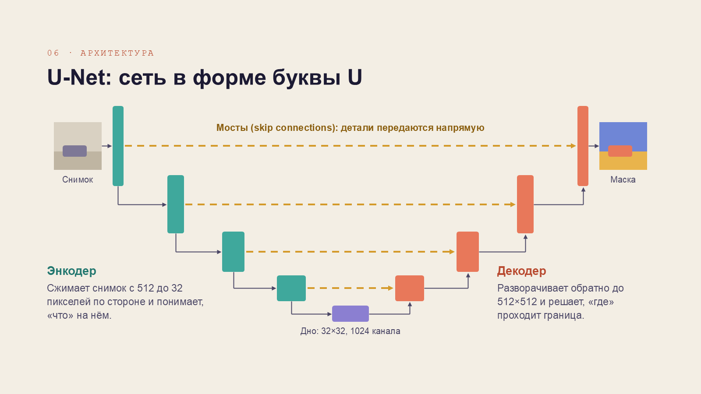

# U-Net и семантическая сегментация

Презентация по курсу «Основы компьютерного зрения». Рассказываем, как нейросеть U-Net определяет класс каждого пикселя на изображении и почему у неё такая форма.

Файлы: [PDF](unet-semantic-segmentation.pdf), [PowerPoint](unet-semantic-segmentation.pptx). Слайды картинками лежат в папке [slides](slides).

## О чём слайды

1. Титульный
2. Четыре задачи компьютерного зрения: классификация, детекция, семантическая и экземплярная сегментация
3. Сколько решений принимает сеть (по одному на пиксель)
4. Что подаётся на вход и что получается на выходе
5. Главная проблема: при сжатии картинки теряется информация о том, где находится объект
6. Архитектура U-Net: энкодер, декодер, skip connections
7. Энкодер
8. Декодер и skip connections
9. Как сеть обучали на 30 снимках
10. Где U-Net используют сейчас

Авторы: Владимир Рихельгоф, Сергей Якимов, группа АА-23-07
